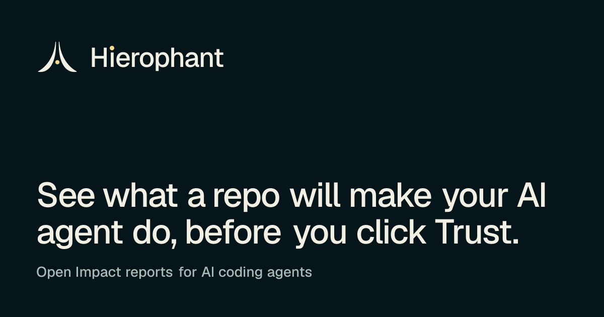

# Hierophant

**Reveals what your agent is about to trust.**

Hierophant checks what you add to your AI coding agent, before you click **Trust**: repositories, npm and PyPI packages, MCP servers, agent skills, and token metadata. It reads public files and metadata as text, then explains what could run or steer your agent. Nothing is installed or executed.

[Start a check](https://hierophanthq.com) · [Docs](https://docs.hierophanthq.com) · [Rule catalog](https://docs.hierophanthq.com/rules) · [Limitations](https://docs.hierophanthq.com/limitations) · [Security](SECURITY.md)

## Why it exists

Opening a repository with an AI coding agent is no longer a passive action. A project can include a hook that runs when a session starts, an editor task that runs when a folder opens, an MCP server that downloads code, or hidden text that steers the agent.

Hierophant answers one question before you trust a project:

> If I open this repo in my agent, what happens?

## What a report shows

- **A verdict:** `Dangerous`, `Needs review`, or `No issues found`, tied to a ruleset version.
- **Open Impact:** what the repository would do in Claude Code, Cursor, VS Code, Antigravity CLI, and Gemini CLI.
- **Evidence:** the file and line for each finding, linked to the exact commit.
- **Fixes:** why each finding matters and what to change.
- **Package checks:** whether packages launched by `npx`, `uvx`, and similar tools are listed as malicious, missing, vulnerable, or newly created.
- **Next steps:** how to open the repository with less risk.

| Open Impact               | Meaning                                                          |
| ------------------------- | ---------------------------------------------------------------- |
| `Runs on open`            | Official documentation says this runs automatically              |
| `Runs after trust prompt` | This runs after you trust the folder or approve a prompt         |
| `Steers the agent`        | This runs no command, but changes the agent's instructions       |
| `Behavior unknown`        | There is a finding, but vendor documentation does not explain it |
| `Not detected`            | No finding affects this agent in this ruleset version            |

## What it checks

The current ruleset, v0.3.0, has 19 rules across five areas:

- **Automatic execution:** session hooks, folder-open tasks, dev container commands, npm install scripts, and helper commands.
- **Remote and concealed code:** downloads piped into a shell, encoded payloads, and obfuscated scripts.
- **MCP servers:** unpinned packages, unrecognized remote hosts, hardcoded credentials, and shell launchers.
- **Instruction injection:** hidden Unicode, override attempts, credential targeting, and hidden HTML comments.
- **Permissions:** project settings that weaken agent approvals.

## Use it

### On the web

Open **[hierophanthq.com](https://hierophanthq.com)**, choose Repo, Package, MCP, Skill, or Token, and paste what you want to check. No install or account is needed. Token checks only read on-chain text and are not a safety rating or investment advice.

### From the command line

It needs Node.js 22.12 or later.

```bash
npx @hierophanthq/cli scan /path/to/repo
```

To install it globally, run `npm install -g @hierophanthq/cli`, then use `hierophant scan`.

Example output:

```text
Hierophant, ruleset v0.3.0
Agent files checked: 1

Status: Dangerous

Open Impact
  Claude Code      Runs after trust prompt
  Cursor           Not detected
  VS Code          Not detected
  Antigravity CLI  Not detected
  Gemini CLI       Not detected

Findings (2)
  CRITICAL AUTO-002 .claude/settings.json:4
    Agent hook reaches the network or runs a concealed script
    Fix: Do not open this repo with an agent until the hook is removed or replaced with a reviewed local command.
  MEDIUM AUTO-001 .claude/settings.json:4
    Agent hook runs when a session starts
    Fix: Read the hook before opening the repo with an agent. Remove it unless you trust what it runs.

These are automated review signals from static checks. They are not a guarantee.
```

Useful options:

```bash
# Fail at a chosen severity
npx @hierophanthq/cli scan . --fail-on medium

# Print JSON
npx @hierophanthq/cli scan . --format json

# Look up package names in OSV, npm, and PyPI
npx @hierophanthq/cli scan . --online
```

The CLI makes no network requests unless you add `--online`, which sends package names and versions only.

### Lock your agent settings

`lock` applies stricter user-level settings that are confirmed in vendor documentation. It previews changes by default and backs up each file before writing.

```bash
npx @hierophanthq/cli lock
npx @hierophanthq/cli lock --apply
npx @hierophanthq/cli lock --undo
```

It supports Claude Code, VS Code, Antigravity CLI, and Gemini CLI. Cursor is not changed because its settings could not be confirmed in official documentation. See the [CLI guide](packages/cli/README.md) for every setting.

### As an MCP server

The MCP server is read-only and can only access the folders you allow.

```bash
claude mcp add hierophant -- npx -y @hierophanthq/cli@0.1.0 mcp --root /absolute/path/to/projects
```

### In GitHub Actions

The action is a preview. It is not on GitHub Marketplace yet and has not been validated on a hosted runner.

```yaml
permissions:
  contents: read

steps:
  - uses: actions/checkout@v6
    with:
      persist-credentials: false
  - uses: hierophant-run/hierophant/packages/action@COMMIT_SHA
    with:
      fail-on: high
```

Replace `COMMIT_SHA` with a full commit SHA. See the [action guide](packages/action/README.md).

## What happens to your data

- Repositories are never cloned, installed, built, or executed.
- Reports store metadata such as file paths, line numbers, and rule IDs. File contents are not stored.
- Code excerpts stay in the browser tab that ran the scan and are not part of a shared link.
- Reports are unlisted and marked `noindex`, but anyone with the link can open them.
- Package lookups send public package names and versions to OSV, npm, and PyPI.

Repository owners can request a correction or removal under the [report policy](https://hierophanthq.com/report-policy).

## Limitations

**A result is not a guarantee.** `No issues found` means one ruleset version matched nothing at one commit. It does not prove that a repository is harmless.

- Static rules can be evaded by rewording or hiding a payload.
- Application code and lockfile dependencies are not analyzed.
- Package results depend on public advisory data, which can be late or incomplete.
- The hosted site reads about 30 files per scan, starting with hooks and configurations, and lists anything it skips.
- Agent behavior can change after its documentation was last checked.

Keep running unfamiliar code in an isolated environment.

## Development

```bash
pnpm install
cp apps/web/.env.example apps/web/.env.local
```

Add `DATABASE_URL` and `GITHUB_TOKEN` to `apps/web/.env.local`, then run:

```bash
pnpm db:migrate
pnpm dev
```

Before opening a pull request:

```bash
pnpm format:check
pnpm lint
pnpm typecheck
pnpm test
pnpm build
```

| Path              | Purpose                                             |
| ----------------- | --------------------------------------------------- |
| `apps/web`        | Next.js website, API, report pages, and docs        |
| `packages/engine` | Pure scanning engine with no network or file access |
| `packages/intel`  | Package lookups through OSV, npm, and PyPI          |
| `packages/local`  | Local file collection for the CLI and GitHub Action |
| `packages/cli`    | CLI, MCP server, and settings lock                  |
| `packages/action` | GitHub Action                                       |

## Security

Please report vulnerabilities privately as described in [SECURITY.md](SECURITY.md). Do not open a public issue.

## License

Hierophant is licensed under the [Apache License 2.0](LICENSE). The license does not grant rights to use the Hierophant name or logo, except to describe where the software came from.
